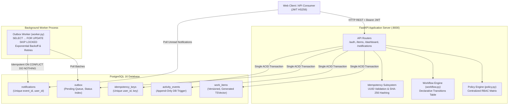

# Newtonite Ops — Operations Under Pressure

Newtonite Ops is an internal operational command center designed to replace chaotic spreadsheet, chat, and email coordination. It coordinates critical customer issues, payment holds, security compliance reviews, and emergency incidents across cross-functional teams with bulletproof concurrency control, four-eyes approval workflows, and an immutable append-only audit trail.

---

## Prerequisites

- **Docker & Docker Compose** (for single-command launch)
- *Optional for local development without Docker:* **Python 3.12+** and **PostgreSQL 16+**

---

## Quick Start (Reviewer Mode)

The entire system (PostgreSQL 16 database, FastAPI application server, and outbox notification worker) launches with a single command:

```bash
docker compose up
```

On first startup:
1. PostgreSQL container starts and passes health checks.
2. The API container automatically runs Alembic database migrations.
3. The API container automatically seeds the database with teams, users across all roles, and ~5,000 work items with realistic timelines and activity events (idempotent, runs only if empty).
4. The background worker polls the outbox queue and processes notifications.
5. Interactive OpenAPI Swagger documentation is served live at: **[http://localhost:8000/docs](http://localhost:8000/docs)**.

To shut down:
```bash
docker compose down -v
```

---

## Demo Credentials

All seeded accounts use the demo password: `password123`

| Role | Email | Name | Primary Team | Notes |
| :--- | :--- | :--- | :--- | :--- |
| **Lead** | `lead.core@newtonite.local` | Maya Chen | Core Platform | Also a **Viewer** in Payments & Risk (cross-team permissions demo) |
| **Member** | `member.core@newtonite.local` | Jordan Patel | Core Platform | Can create items, claim unassigned items, comment, and resolve |
| **Viewer** | `viewer.core@newtonite.local` | Alex Taylor | Core Platform | Read-only access to Core Platform items; cannot mutate |
| **Lead** | `lead.payments@newtonite.local` | Rehan Ahmed | Payments & Risk | Can approve high-value transactions and reassign tickets |
| **Member** | `member.payments@newtonite.local` | Elena Rostova | Payments & Risk | Operates payment investigation workflow |
| **Lead** | `lead.compliance@newtonite.local`| Priya Sharma | Compliance & Security | Enforces regulatory compliance and four-eyes review |

---

## Running the Automated Test Suite

Run all tests against real PostgreSQL with a single command:

```bash
make test
```

The test suite runs 21 comprehensive integration and concurrency tests against a real PostgreSQL instance (no mock databases):

1. **Claim Race Test (`test_claim_race.py`)**: 20 concurrent threads compete to claim one open item on separate database connections. Proves exactly one 200 winner, nineteen 409 `already_claimed` conflicts, one assignee, and one `claimed` activity event.
2. **Stale Writes Test (`test_stale_writes.py`)**: Competing concurrent PATCH operations with matching `expected_version`. Proves one 200 success, one 409 `version_conflict`, and zero lost updates.
3. **Idempotency Test (`test_idempotency.py`)**: Sequential and concurrent duplicate creates produce exactly one item and one event; same key with different body produces 422 `idempotency_key_reused`; rolled-back transactions do not consume the idempotency key.
4. **Workflow Rules Test (`test_workflow.py`)**: Invalid state transitions rejected; non-lead approval rejected; assignee self-approval rejected (four-eyes rule); approval requirements enforced; reason requirements strictly enforced on rejections, cancels, and re-opens.
5. **Authorization Policy Test (`test_auth_policy.py`)**: Role x action matrix; cross-team access returns 404 (does not leak existence); viewers cannot mutate items.
6. **Atomicity Test (`test_atomicity.py`)**: If activity event or outbox insertion fails, item state mutations roll back completely.
7. **Outbox Worker Test (`test_worker.py`)**: Two concurrent worker threads process outbox records with `SKIP LOCKED` without collisions; duplicate event delivery produces exactly one notification (`ON CONFLICT DO NOTHING`); exponential backoff retry transitions to `dead` after 5 attempts.
8. **Keyset Pagination Test (`test_pagination.py`)**: Keyset cursor pagination produces zero duplicates and zero skipped items even when new rows are inserted between page queries.
9. **Append-Only Trigger Test (`test_activity_events_trigger.py`)**: PostgreSQL trigger explicitly rejects any `UPDATE` or `DELETE` on the `activity_events` audit table.

---

## Architecture Diagram



---

## API Contract Overview

| Method | Endpoint | Auth | Idempotent | Description |
| :--- | :--- | :---: | :---: | :--- |
| `POST` | `/auth/login` | No | No | Authenticate user credentials; returns JWT bearer token |
| `GET` | `/me` | Yes | No | Get current authenticated user details and team memberships |
| `GET` | `/teams/{team_id}/members` | Yes | No | Get member roster for a team (404 if caller not in team) |
| `POST` | `/items` | Yes | **Yes** | Create new work item (requires `Idempotency-Key` header) |
| `GET` | `/items` | Yes | No | Keyset paginated items list with filters (`view`, `q`, `sort`, `cursor`, `limit`) |
| `GET` | `/items/{id}` | Yes | No | Get item details with computed `allowed_actions` |
| `PATCH` | `/items/{id}` | Yes | No | Optimistic concurrency update (`expected_version` required) |
| `POST` | `/items/{id}/claim` | Yes | **Yes** | Atomic claim via single conditional SQL `UPDATE` |
| `POST` | `/items/{id}/release` | Yes | **Yes** | Release item back to unassigned `open` state |
| `POST` | `/items/{id}/assign` | Yes | **Yes** | Assign/reassign item to team member (lead only) |
| `POST` | `/items/{id}/transition`| Yes | **Yes** | Transition workflow status with rule validation & reason checks |
| `POST` | `/items/{id}/comments` | Yes | **Yes** | Append comment event to item history |
| `GET` | `/items/{id}/activity` | Yes | No | Keyset paginated item activity timeline and discussion |
| `GET` | `/dashboard/summary` | Yes | No | Dashboard metrics (`assigned_to_me`, `unassigned_urgent`, `awaiting_my_approval`, `overdue`, `stale`) |
| `GET` | `/notifications` | Yes | No | Keyset paginated notification feed (`unread_only`, `cursor`, `limit`) |
| `GET` | `/notifications/unread-count` | Yes | No | Fast count of unread notifications |
| `POST` | `/notifications/{id}/read` | Yes | No | Mark single notification as read (returns 204) |
| `POST` | `/notifications/read-all` | Yes | No | Mark all notifications for caller as read (returns 204) |

---

## Database Query Execution Plans (`EXPLAIN ANALYZE`)

The following execution plans were generated directly on PostgreSQL 16 with the seeded database:

### 1. Active Work Items Query (Filtered by Team & Active Status, Keyset Ordered)
```text
EXPLAIN (ANALYZE, BUFFERS)
SELECT id, team_id, title, type, status, priority, assignee_id, created_by, requires_approval, due_at, version, created_at, updated_at, last_activity_at
FROM work_items
WHERE team_id = 1
  AND status IN ('open', 'in_progress', 'awaiting_approval')
ORDER BY updated_at DESC, id DESC
LIMIT 50;

                                                                  QUERY PLAN                                                                   
-----------------------------------------------------------------------------------------------------------------------------------------------
 Limit  (cost=513.07..513.19 rows=50 width=151) (actual time=1.437..1.444 rows=50 loops=1)
   Buffers: shared hit=394
   ->  Sort  (cost=513.07..515.51 rows=975 width=151) (actual time=1.436..1.438 rows=50 loops=1)
         Sort Key: updated_at DESC, id DESC
         Sort Method: top-N heapsort  Memory: 47kB
         Buffers: shared hit=394
         ->  Bitmap Heap Scan on work_items  (cost=47.84..480.68 rows=975 width=151) (actual time=0.694..1.121 rows=973 loops=1)
               Recheck Cond: ((team_id = 1) AND ((status)::text = ANY ('{open,in_progress,awaiting_approval}'::text[])))
               Heap Blocks: exact=381
               Buffers: shared hit=394
               ->  Bitmap Index Scan on idx_work_items_active  (cost=0.00..47.59 rows=975 width=0) (actual time=0.655..0.655 rows=973 loops=1)
                     Index Cond: (team_id = 1)
                     Buffers: shared hit=13
 Planning Time: 0.250 ms
 Execution Time: 1.465 ms
```

### 2. Unassigned Urgent Query (Using Partial Index `idx_work_items_unassigned_urgent`)
```text
EXPLAIN (ANALYZE, BUFFERS)
SELECT id, team_id, title, type, status, priority, assignee_id, created_by, requires_approval, due_at, version, created_at, updated_at, last_activity_at
FROM work_items
WHERE team_id = 1
  AND assignee_id IS NULL
  AND status = 'open'
  AND priority = 4
LIMIT 50;

                                                                   QUERY PLAN                                                                    
-------------------------------------------------------------------------------------------------------------------------------------------------
 Limit  (cost=4.27..43.10 rows=11 width=151) (actual time=0.066..0.377 rows=34 loops=1)
   Buffers: shared hit=40
   ->  Bitmap Heap Scan on work_items  (cost=4.27..43.10 rows=11 width=151) (actual time=0.064..0.367 rows=34 loops=1)
         Recheck Cond: ((team_id = 1) AND (priority = 4) AND (assignee_id IS NULL) AND ((status)::text = 'open'::text))
         Heap Blocks: exact=33
         Buffers: shared hit=40
         ->  Bitmap Index Scan on idx_work_items_unassigned_urgent  (cost=0.00..4.26 rows=11 width=0) (actual time=0.046..0.047 rows=34 loops=1)
               Index Cond: ((team_id = 1) AND (priority = 4))
               Buffers: shared hit=7
 Planning Time: 1.980 ms
 Execution Time: 0.425 ms
```

### 3. Full-Text Websearch Query (Using GIN Index `idx_work_items_search_vector`)
```text
EXPLAIN (ANALYZE, BUFFERS)
SELECT id, team_id, title, type, status, priority, assignee_id, created_by, requires_approval, due_at, version, created_at, updated_at, last_activity_at
FROM work_items
WHERE team_id IN (1, 2, 3, 4)
  AND search_vector @@ websearch_to_tsquery('english', 'latency spike')
ORDER BY updated_at DESC, id DESC
LIMIT 50;

                                                                     QUERY PLAN                                                                      
-----------------------------------------------------------------------------------------------------------------------------------------------------
 Limit  (cost=76.79..76.83 rows=16 width=151) (actual time=1.563..1.575 rows=50 loops=1)
   Buffers: shared hit=217
   ->  Sort  (cost=76.79..76.83 rows=16 width=151) (actual time=1.562..1.565 rows=50 loops=1)
         Sort Key: updated_at DESC, id DESC
         Sort Method: top-N heapsort  Memory: 46kB
         Buffers: shared hit=217
         ->  Bitmap Heap Scan on work_items  (cost=21.59..76.47 rows=16 width=151) (actual time=0.112..1.366 rows=279 loops=1)
               Recheck Cond: (search_vector @@ '''latenc'' & ''spike'''::tsquery)
               Filter: (team_id = ANY ('{1,2,3,4}'::bigint[]))
               Heap Blocks: exact=206
               Buffers: shared hit=211
               ->  Bitmap Index Scan on idx_work_items_search_vector  (cost=0.00..21.59 rows=16 width=0) (actual time=0.080..0.080 rows=279 loops=1)
                     Index Cond: (search_vector @@ '''latenc'' & ''spike'''::tsquery)
                     Buffers: shared hit=5
 Planning Time: 11.858 ms
 Execution Time: 1.641 ms
```

---

## Known Limitations

1. **Short-polling vs WebSockets:** Real-time frontend updates rely on polling `/notifications/unread-count` and `/items` rather than persistent WebSocket connections or Server-Sent Events (SSE).
2. **Single-token Auth (No Refresh Token Rotation):** Authentication uses a single 24-hour signed JWT access token without refresh token rotation or server-side revocation lists.
3. **Basic Full-Text Search:** Search uses PostgreSQL standard English stemming dictionaries without trigram typo tolerance (`pg_trgm`) or fuzzy matching.
4. **No Rate Limiting:** While idempotency prevents duplicate side-effects, there is currently no IP or user-based token bucket rate limiter on the public API endpoints.
5. **No Long-Term Audit Archival:** The `activity_events` table is append-only and retains all historical events in the primary database indefinitely.

---

## Next Week I Would...

1. **Database Partitioning for Audit History:** Implement monthly declarative table partitioning on `activity_events` using `RANGE (created_at)` to keep index sizes bounded as the history grows into millions of records.
2. **Server-Sent Events (SSE) for Notifications:** Add a lightweight SSE endpoint `GET /notifications/stream` leveraging PostgreSQL `LISTEN / NOTIFY` to eliminate client polling overhead.
3. **Fuzzy Search with `pg_trgm`:** Add trigram indexing to support search queries with spelling errors and partial key lookups (e.g. typing "OPS-14" finding "OPS-142").
4. **Sliding-Window Rate Limiting:** Add token-bucket rate limiting via ASGI middleware for mutating endpoints to protect against DDoS and runaway client loops.
5. **OpenTelemetry Distributed Tracing:** Instrument FastAPI endpoints and database transactions with trace spans to monitor query latency distributions in real time.
